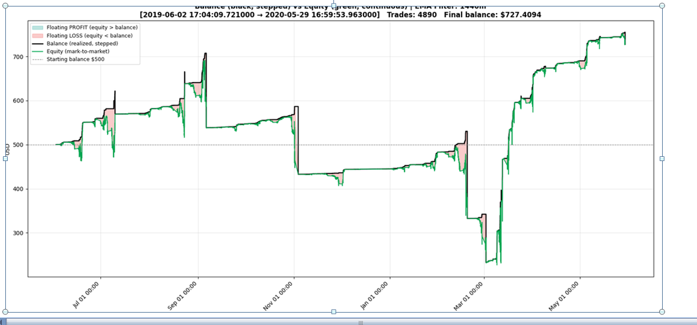
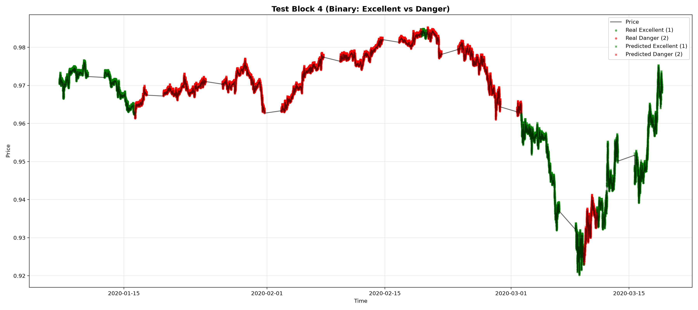
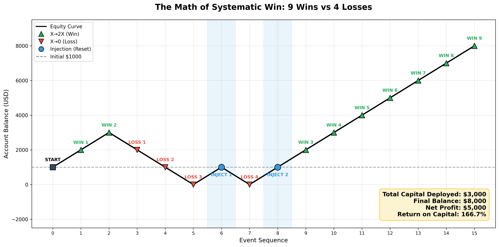

# Tick-Level Regime Backtester & ML Filter (R&D)

**Author:** Vlad Agapov, PhD (Applied Mathematics, University of Alberta)
**Status:** Active R&D (Dual-State Architecture + RL Regime Filter)

## 📊 Visual Proof of Concept

### 1. The Problem: Static Grids Bleed in Trends

*Static grid strategy over 11 months of tick data (USDCHF). High volatility periods (March 2020) cause severe drawdowns.*

### 2. The Solution: ML-Based Regime Filter

*Random Forest Classifier predicting "Safe" (Green) vs "Dangerous" (Red) regimes. The model successfully keeps the strategy out of the market during high-volatility crashes (63% of the time).*

### 3. The Math: Capped Bets + Reallocation

*We frame each stochastic process as a binary outcome: X -> 0 (Stop Loss) or X -> 2X (Take Profit). By capping losses and reallocating capital, we turn a choppy equity curve into a consistent winner.*

## 🛠️ The Dual-State Architecture (Next Step)
We are moving from a static filter to a fully dynamic Dual-State engine:
- **State 1 (Low Vol):** Mean-reversion grid.
- **State 2 (High Vol):** Directional momentum ladder.

The core backtesting engine (tick-accurate, no look-forward bias) is currently being modularized for pilot deployments.

## 💼 Available for R&D Pilots
I am looking for 1-2 quantitative funds to run a **1-week paid pilot**. 
- You provide tick data.
- I calibrate the CatBoost/RL classifier.
- You test the resulting signal in your sandbox.

**Contact:**
- GitHub: [VladAgapov1969](https://github.com/VladAgapov1969)
- LinkedIn: [Vladislav Agapov](https://www.linkedin.com/in/vladislav-agapov-937921385)
- Telegram: @agapov_vl
